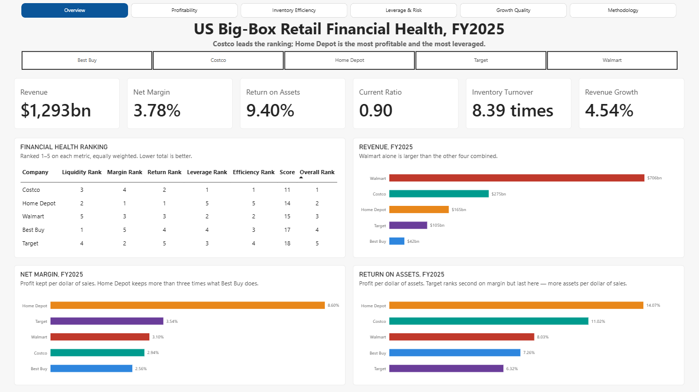
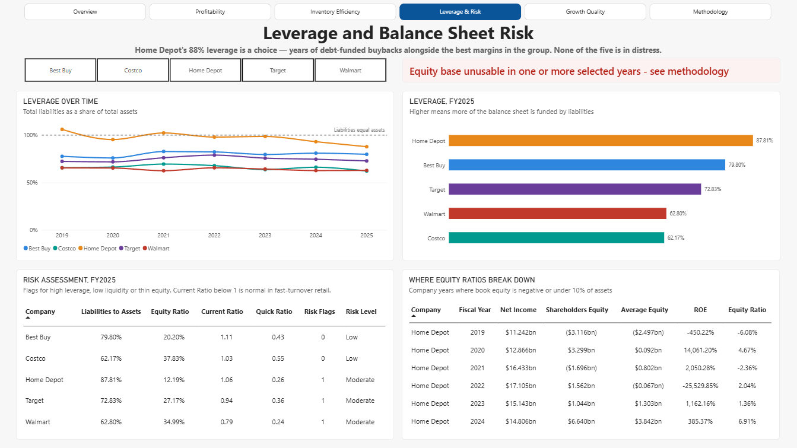
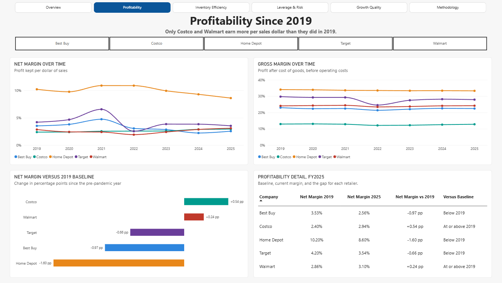
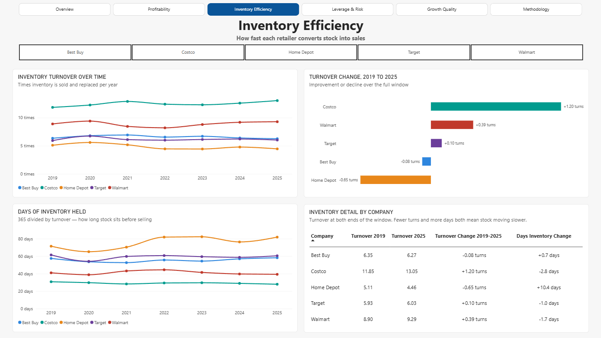
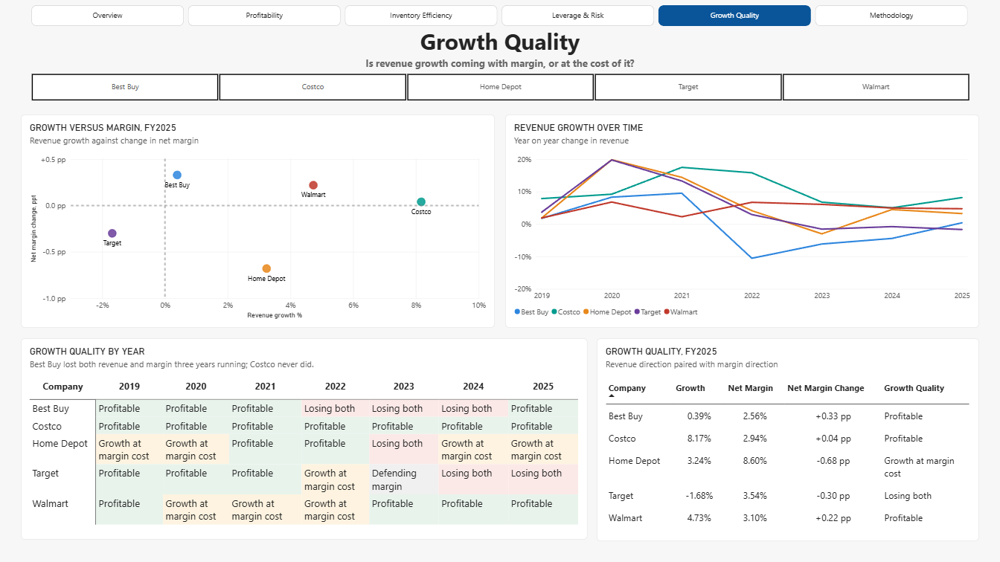

# US Big-Box Retail Financial Health — SQL Server + Power BI

**Which of America's five largest big-box retailers is in the strongest financial position, and what did the last six years cost each of them?**

Six-page Power BI report on a layered SQL Server warehouse. Data is the [SEC XBRL company facts API](https://www.sec.gov/edgar/sec-api-documentation) — the complete filing history for Walmart, Costco, Target, Home Depot and Best Buy, extracted with no pre-filtering: 121,846 rows across 1,212 accounting tags, narrowed to 35 audited company-years covering FY2019 to FY2025.

**Stack:** Python (extraction) · SQL Server (T-SQL) · SSMS · Power BI Desktop · DAX · 19 measures
**Data through:** FY2025 filings, extracted August 2026

---

## Key findings



**Costco leads the ranking, but the ranking is a choice.** Scored 1–5 across liquidity, margin, return, leverage and efficiency with equal weights, Costco totals 11 against Home Depot's 14. Weight return and margin more heavily — which most analysts would argue for — and Home Depot wins outright, ranking first on both. The equal weighting is stated on the page rather than assumed, because any other weighting encodes a view the data can't support.



**Home Depot's 88% leverage is deliberate, not distress.** It funds 87.81% of its balance sheet with liabilities and still earns the best net margin (8.60%) and the best return on assets (14.07%) in the group. These are the same story: sustained debt-funded buybacks shrink book equity while the business keeps earning. Equity turned negative in FY2019 and FY2021 as a result, which is why equity ratios are unusable for this company in six of its seven years.



**Only two of five earn more per sales dollar than before the pandemic.** Costco (+0.54 pp) and Walmart (+0.24 pp) sit above their FY2019 baseline; Target (−0.66), Best Buy (−0.97) and Home Depot (−1.60) sit below it. Gross margin barely moves across the same window, so most of the volatility is in operating costs rather than in what inventory costs — the exception being Target's FY2022, where gross margin itself dropped sharply.



**Costco widened its efficiency lead while Home Depot slowed.** Costco went from 11.85 to 13.05 inventory turns and cut 2.8 days of holding; Home Depot fell from 5.11 to 4.46 turns and added 10.4 days. Turnover is partly a function of what a retailer sells — groceries move, lumber and appliances don't — so the direction of travel matters more than the level.



**Best Buy lost both revenue and margin three years running; Costco never did.** FY2022 through FY2024 is the only three-year run in the worst quadrant anywhere in the dataset. The pattern fits a demand pull-forward and reversal — consumer electronics saw exceptional demand in 2020–21 as households equipped themselves for remote work, bringing forward purchases of goods people replace once every five to seven years. Best Buy returned to profitable growth in FY2025. This is inferred from the pattern rather than read from a filing.

---

## How it's built

```
SEC JSON → Python (flatten, no filtering) → CSV
    → src        raw load, 121,846 rows, all 1,212 tags
    → cleaned    typed → deduped → normalized
    → analytics  prior-year values, ratios, trends
    → reporting  6 views → Power BI (19 measures)
```

Python does no analysis — it flattens every tag the filers used, so tag selection stays visible in SQL where it can be read and argued with. Chapters `01`–`02` validate and profile, `03`–`05` clean, `06`–`07` calculate, `08` explores the five business questions, `09` exposes the views Power BI reads.

Two rules hold throughout. Business logic lives in SQL; DAX only handles what has to recompute when the user filters — which is why every ratio measure divides summed dollars rather than averaging ratios, so a sector figure weights Walmart's $706bn above Best Buy's $42bn. And the FY2019–2025 window is applied in the reporting layer only, so year-on-year changes and two-year average balances can still reach back to FY2018.

---

## What the validation caught

**SEC's own `fiscal_year` column is unreliable.** Roughly 80% of filing periods carry more than one year label across filings — one Best Buy period appears as 2011, 2013 and 2015. Fiscal year is derived from `period_end` instead, which is the only reason the five companies line up at all.

**Three of the five never report total liabilities.** Walmart, Target and Best Buy omit the `Liabilities` tag entirely. It's derived from the accounting identity — Assets − Parent Equity − Non-controlling Interests — and every derivation is labelled on the Methodology page rather than hidden.

**Target changed net income tags mid-window.** FY2019 uses `NetIncomeLossAvailableToCommonStockholdersBasic`; FY2020 onward uses `NetIncomeLoss`. Revenue appears under three different tag names across the group. Each concept coalesces its variants in priority order, with the choice recorded per company-year.

**Two figures were restated.** Target's cost of goods sold for FY2022 and FY2023, both revised in the FY2024 10-K by under 0.15% — too small to move any conclusion, but COGS feeds both gross margin and inventory turnover, so it was worth confirming rather than assuming. The pipeline keeps the most recently filed version of every figure.

**Home Depot's negative equity inverts ROE.** FY2019 reads −450% return on equity in a year the company earned $11.2bn. No company reported a loss in the window, so any negative equity ratio here comes from the denominator — which is exactly what the `equity_ratios_comparable` flag exists to say.

---

## Limitations and what this supports next

- **Costco's fiscal year ends five months before the others'** (late August vs late January/early February). Years carry the same label but cover different periods.
- **Best Buy reports revenue including assessed taxes**, so its margins are marginally understated against peers.
- **Equity ratios are unusable for Home Depot in six of seven years.** ROE and debt-to-equity are kept for single-company views with flags, never for ranking.
- **The ranking is equally weighted.** A different weighting produces a different winner — the component ranks are exposed so anyone with a view can reweight it.
- **The source contains only reported actuals**, so no variance analysis. Everything is entity-level, because that is what XBRL company facts expose; segment detail would need the filings themselves.
- **Extending the peer group is cheap.** The tag-coalescing logic is written for variance, not for these five filers — adding Kroger or Lowe's is a row in `src.dim_company` and a rerun.

---

## Running it

The five source files come from SEC's companyfacts endpoint — `https://data.sec.gov/api/xbrl/companyfacts/CIK##########.json`, using the zero-padded CIK for Walmart (`0000104169`), Costco (`0000909832`), Target (`0000027419`), Best Buy (`0000764478`) and Home Depot (`0000354950`). SEC requires a `User-Agent` header identifying you if you fetch them programmatically.

1. Save the five JSON files into `Raw/` as `walmart.json`, `costco.json`, `target.json`, `bestbuy.json`, `homedepot.json` and run `Raw/extract_to_csv.py` to produce the CSVs.
2. Run `SQL/01__Import_validation.sql` to create the schemas and the company dimension, then load the CSVs via its `BULK INSERT` statements — adjust the paths to wherever the CSVs live.
3. Run `SQL/02` through `SQL/09` in order.
4. Open `PowerBI/Retails.pbix` and refresh against the `reporting` schema.

```
Raw/          extraction script, SEC JSON, generated CSVs
SQL/          the nine pipeline chapters, run in order
PowerBI/      the .pbix report
Screenshots/  report pages used above
```
